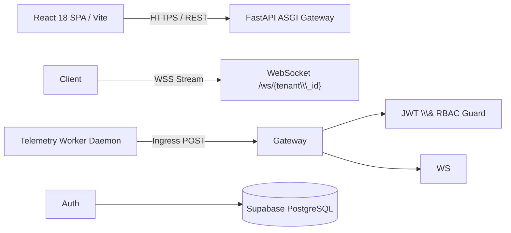

# Multi-Tenant SaaS Analytics Platform

> Real-time tenant-isolated observability, telemetry stream processing, and RBAC workspace management for modern SaaS applications.

[!\[CI](https://github.com/rajkelangork-alt/tenant-saas-analytics/actions/workflows/ci.yml/badge.svg)(https://github.com/rajkelangork-alt/tenant-saas-analytics/actions)
!\[Python](https://img.shields.io/badge/python-3.12-blue)
!\[FastAPI](https://img.shields.io/badge/FastAPI-009688)
!\[React](https://img.shields.io/badge/React-18-61DAFB)
!\[License](https://img.shields.io/badge/license-MIT-green)

**Live demo:** [tenant-saas-analytics.vercel.app](https://tenant-saas-analytics.vercel.app) |
**API docs:** [tenant-saas-analytics-api.onrender.com/docs](https://tenant-saas-analytics-api.onrender.com/docs)

### Demo logins
```
|Role         |Email                |Password       |Access                                                            |
|             |                     |               |                                                                  |
|Tenant Admin |`admin@tenant1.com`  |`Admin@12345`  |Full workspace administration, API key rotation, team provisioning|
|Tenant Member|`analyst@tenant1.com`|`Analyst@12345`|Read-only analytics inspection, telemetry logs                    |

```

## 1. Problem & Solution

* **Problem:** Modern multi-tenant SaaS providers struggle to give customers direct visibility into their API consumption, operational latencies, and service usage without risking cross-tenant data leaks or deploying expensive per-tenant infrastructure.
* **Solution:** An asynchronous, multi-tenant analytics engine that enforces query-level row isolation via tenant UUIDs, streams live telemetry events over low-latency WebSockets, and offers granular role-based access control.
* **Outcome:** Tenant data isolation on shared infrastructure, sub-50ms query responses backed by asynchronous database connection pooling, and real-time visualization of high-throughput traffic.

## 2. Key Features

* **Strict multi-tenant isolation:** Database queries append `WHERE tenant\\\_id = :tenant\\\_id` filters, preventing cross-tenant leakage on shared infrastructure.
* **Real-time telemetry pipeline:** Bi-directional WebSockets (`/ws/{tenant\\\_id}`) stream live ingestion events directly into animated SVG charts and auto-scrolling telemetry monitors.
* **Granular RBAC workspace administration:** Admins can invite users, reassign roles (`tenant\\\_admin` vs `member`), toggle active/suspended status, and are prevented from self-deletion.
* **Ingress credential lifecycle:** Masked bearer API secret keys (`sk\\\_live\\\_...`) with instant key rotation and revocation for external worker pipelines.
* **Data portability \& auditability:** Client-side sanitized RFC 4180 CSV export for reporting, compliance checks, and external BI tool ingestion.

## 3. Architecture



### Design decisions
```
|Decision        |Choice                             |Why                           |Alternative      |
|                |                                   |                              |                 |
|Multi-tenancy   |Shared DB + tenant UUID column     |Lower cost, simpler operations|Schema-per-tenant|
|Real-time stream|WebSockets                         |Instant push, no polling      |SSE, long polling|
|Authentication  |Stateless JWT (HS256) + RBAC       |Scales horizontally           |Redis sessions   |
|Database        |PostgreSQL + async SQLAlchemy      |Non-blocking pooling          |MongoDB, SQLite  |
```
Full write-ups: [`docs/architecture.md`](docs/architecture.md) and [`docs/adr/`](docs/adr/) (Architecture Decision Records).

## 4. Tech Stack
```
|Layer            |                             Technology                                    |
|                 |                                                                           |
|Backend          |Python 3.12, FastAPI, Uvicorn, SQLAlchemy (Asyncio), Pydantic v2, Alembic  |
|Data             |PostgreSQL (Supabase pooler), asyncpg|
|Frontend         |React 18, Vite, React Router DOM v6, Tailwind CSS, Recharts, Lucide React  |
|DevOps & Cloud   |GitHub Actions (CI/CD), Vercel (frontend SPA), Render (FastAPI web service)|
|Quality & Tooling|Pytest, HTTPX Async Client, ESLint, Prettier                               | 
```


## 5. Project Structure

```
.
├── be/                         # FastAPI backend application
│   ├── alembic/                # Database migrations
│   ├── app/
│   │   ├── api/v1/endpoints/   # Versioned REST endpoints (auth, analytics, users, tenants)
│   │   ├── core/               # App configuration, security, hashing, CORS
│   │   ├── db/                 # SQLAlchemy async engine, session makers, base models
│   │   ├── models/             # ORM entities (Tenant, User, TelemetryEvent)
│   │   ├── schemas/            # Pydantic v2 request/response schemas
│   │   ├── services/           # Reusable business logic layer
│   │   ├── ws/                 # WebSocket connection managers and streaming routes
│   │   └── main.py             # FastAPI entrypoint, middleware, and router bindings
│   ├── tests/                  # Pytest suites (auth, tenancy, endpoints)
│   └── requirements.txt        # Backend dependencies
├── fe/                         # React frontend application
│   ├── src/
│   │   ├── components/         # Reusable layouts, navigation, and modal dialogs
│   │   ├── context/            # Global AuthContext \\\& state providers
│   │   ├── pages/              # Overview, Analytics, Team Management, Settings
│   │   ├── services/           # Axios interceptors and WebSocket clients
│   │   └── index.jsx           # Application entrypoint
│   └── vercel.json             # SPA routing rewrite configuration
├── .github/workflows/          # GitHub Actions CI/CD workflows
└── README.md
```

## 6. API Overview
```
|Method  |Endpoint                           |Description                                                 |Auth         |
|
|POST    |`/api/v1/auth/login`               |Authenticate user credentials and return a bearer JWT       |Public       |
|GET     |`/api/v1/analytics/overview`       |Fetch aggregate KPIs, concurrency, and volume counts        |Tenant User  |
|GET     |`/api/v1/analytics/breakdown`      |Fetch endpoint latency, status distribution, and percentiles|Tenant User  |
|GET     |`/api/v1/users`                    |List workspace team members with query pagination           |Tenant User  |
|POST    |`/api/v1/users`                    |Provision a new team member and hash credentials            |Tenant Admin |
|PUT     |`/api/v1/users/{user\\\_id}/status`|Activate, suspend, or update member roles                   |Tenant Admin |
|GET     |`/api/v1/tenants/settings`         |Read workspace identity and ingress secret tokens           |Tenant Admin |
|POST    |`/api/v1/tenants/roll-key`         |Invalidate the current key and issue a new ingress secret   |Tenant Admin |
|WS      |`/ws/{tenant\\\_id}`               |Real-time bi-directional telemetry broadcast socket         |Tenant Scoped|
```


## 7. Getting Started

**Prerequisites:** Python 3.12+, Node.js 18+ and npm, a PostgreSQL instance (Supabase project).

### Backend

```bash
cd be
python -m venv venv

# Windows (PowerShell)
.\venv\Scripts\Activate.ps1
# macOS / Linux
source venv/bin/activate

pip install -r requirements.txt
cp .env.example .env     # add your database URL and JWT secret
uvicorn app.main:app --reload --port 8000
```

### Frontend

```bash
cd fe
npm install
npm run dev
```

## 8. Testing & Quality

```bash
cd be
pytest tests/ -v
```

## 9. Security

* **Password hashing:** bcrypt via passlib with salted hashes; secrets are managed through environment variables only.
* **Tenant isolation:** Enforced by UUID scoping on every tenant-owned table and query path.
* **Payload sanitization:** Pydantic v2 schemas reject unexpected attributes and strip sensitive hashes from JSON responses.
* **Public repo safe:** No credentials or `.env` files are tracked in source control. Demo accounts are for the hosted demo only.

## 10. Performance & Scalability

* **Non-blocking I/O:** Async Python (`async/await`) with asyncpg connection pools handles high-concurrency event ingestion without thread starvation.
* **Real-time push:** WebSocket delivery removes continuous client HTTP polling overhead.
* **Optimized client builds:** Vite bundles with code splitting and client-side route caching.

## 11. Deployment

* **Frontend:** Vercel, with SPA rewrites (`vercel.json`) and edge distribution.
* **Backend:** Render, as a Python ASGI web service connected to Supabase PostgreSQL.
* **CI/CD:** GitHub Actions (`.github/workflows/ci.yml`).

## 12. What I Learned & Trade-offs

* Tenant isolation currently relies on application-level `tenant_id` filters. At larger scale I would add PostgreSQL Row-Level Security as a second layer of defence.
* WebSocket connections are managed per server instance. Running multiple instances would need a shared pub/sub layer such as Redis to broadcast events across them.
* HS256 JWTs are simple and fast, but a larger system would move to asymmetric keys (RS256) with key rotation.
* Telemetry storage in a single PostgreSQL table works for this scale. High-volume ingestion would call for partitioning or a time-series store.

## 13. Author

**Product Full Stack Developer** | Python/FastAPI, React/Next.js, TypeScript

GitHub: [@rajkelangork-alt](https://github.com/rajkelangork-alt) | Live platform: [tenant-saas-analytics.vercel.app](https://tenant-saas-analytics.vercel.app)

Available for freelance projects.

